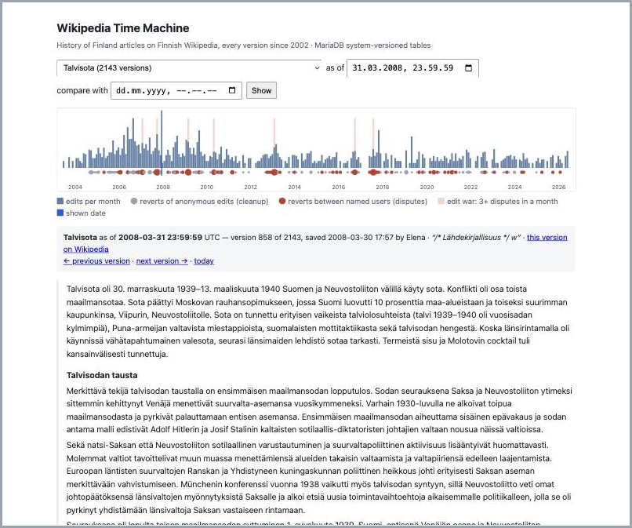

# Wikipedia Time Machine with MariaDB System-Versioned Tables

> **Status:** built, measured and tested. Anything marked **(to verify)** is not checked yet.
>
> **Developed against MariaDB 12.2.2** (Homebrew, macOS); the Docker route was tested with
> `mariadb:lts`, which was **12.3.3** in October 2026. Needs 10.11 or later
> (`system_versioning_insert_history`).

Pick a Wikipedia article and a moment, and read the article as it stood then. See its whole life
on a timeline — when it was edited most, and where people kept undoing each other's edits — and
compare any two moments.

The history is not kept by application code or a revision table filled by hand: the table is
declared `WITH SYSTEM VERSIONING`, and MariaDB keeps every earlier version itself.
`SELECT … FOR SYSTEM_TIME AS OF '2015-06-01'` returns the table as it was at that moment.

Built as an example of system-versioned tables in MariaDB. The data is the edit history of
Finnish Wikipedia articles on the *History of Finland* — the same subject as
[mariadb-vector-wikipedia-rag](https://github.com/MariaDB/mariadb-vector-wikipedia-rag), so the
two can be combined: *"what did Wikipedia say about this in 2015, and what has changed since?"*



## Quick start

You need Python 3.11+, Docker, and 7-Zip's command-line program (`brew install 7-zip`). Then:

```bash
git clone https://github.com/MariaDB/mariadb-system-versioning-wikipedia.git
cd mariadb-system-versioning-wikipedia
./setup.sh                  # packages, MariaDB in Docker, the history dumps, the load
.venv/bin/python app.py     # the time machine: http://localhost:8000
```

`setup.sh` downloads ~3.4 GB of Wikipedia history dumps (~35 min at 1.6 MB/s) and loads them.
From a fresh clone with the dumps already downloaded: 17 min 40 s, all of it loading
(MariaDB 12.3.3 in Docker) — same 31,848 versions, tests passing.

## What we found

- **Real timestamps work.** With `system_versioning_insert_history`, 31,848 versions of 50
  articles (2003–2026) went in with the times they were saved on Wikipedia, and
  `FOR SYSTEM_TIME AS OF` answers "what did it say on that day". An ordinary database user can
  do it; no special privilege.
- **"As of" is fast, but not faster than a plain revision table.** Every query took 0.04–0.65 ms.
  For old dates the plain table with an index was up to 15× faster — until we added an index on
  `(page_id, row_start)`: MariaDB's own history index is ordered by when a version *ended*, so
  "as of 2005" walked every later version. With the extra index, all designs land at
  0.04–0.28 ms.
- **Partitioning by year did not speed anything up at this size.** A version is filed under the
  year it *stopped* being current, so "as of 2005" still reads 23 of the 25 partitions in use;
  only recent dates read few (2 for today). The partitioned table is 25% bigger on disk
  (1,196 MB against 956 MB). Its real use is managing growth: dropping or archiving old years.
- **Compression: use `COMPRESSED` columns on a Mac.** InnoDB page compression compressed the
  pages but saved no disk on macOS (no "punch hole" support); column compression did: 2,049 MB of
  wikitext in 1,202 MB.
- **Most reverts are cleanup, not edit wars.** *Talvisota* has 328 reverts; 240 undo an edit by
  an anonymous editor. Telling the two apart needs the editor's name — and Wikipedia's 2025 switch
  from IP addresses to temporary accounts (`~2026-33532-4`) changes what "anonymous" looks like.
- **Limits met on the way:** no `CREATE TEMPORARY TABLE` with system versioning; a prepared
  statement's `TIMESTAMP ?` refuses a bare date; a batch of long versions exceeds the default
  16 MB packet, so the loader sends batches by size, not by row count.

## Choices, and why

### The data: Finnish edit history, from Wikipedia's dumps

- **Which articles:** the 50 in [data/articles.tsv](data/articles.tsv), each with the reason it is
  there: the 32 articles that answer the test questions of the RAG demo, the five presidents
  (*Ståhlberg*, *Svinhufvud*, *Mannerheim*, *Paasikivi*, *Kekkonen*), and 13 of the longest — and
  so most edited — articles of the set (*Lapuanliike*, *Suomi 1980-luvulla*, the COVID-19 timeline
  …). All ~19,750 *History of Finland* articles are one option of the same loader:
  `python load.py --list data/articles-all.tsv` *(to do)*.
- **Which source:** the `pages-meta-history` dumps of 1 October 2026 on
  [dumps.wikimedia.org](https://dumps.wikimedia.org/fiwiki/20261001/): every saved version of every
  page on Finnish Wikipedia, with its text, time, editor and edit summary. 16 files, 4.5 GB as
  `.7z`; each holds one range of page ids, so `download.py` fetches only the 12 that contain our
  articles (~3.4 GB). `load.py` streams them through 7-Zip and keeps our articles; nothing big
  is unpacked to disk.
- **Why not the Wikipedia API:** one long article has thousands of versions of tens of KB each.
  Fetching that from the live servers is the load the dumps exist to avoid.
- **Finnish only.** English Wikipedia's full history is ~300 GB compressed.
- **Text: raw wikitext.** Wikipedia keeps old versions only as wikitext. The page shows it
  lightly cleaned (`history.py`): templates, tables and references dropped, links turned into
  words. Each version links to the real thing on Wikipedia (`?oldid=<rev_id>`).
- **Missing from the dumps:** versions an administrator has hidden. The dumps carry only what
  anyone may see.

### The key decision: whose time is "system time"?

A system-versioned table records *when a row changed in the database*. Our rows changed on
Wikipedia, years before we load them. Three ways to handle that:

| | How | Result |
|---|---|---|
| **a. Replay** | Insert the versions in order, as ordinary `INSERT` and `UPDATE` statements | Every version gets *today's* load time. The history is there, but "as of 2015" means nothing. |
| **b. True timestamps** *(our choice)* | Write the history rows with their real Wikipedia times, using [`system_versioning_insert_history`](https://mariadb.com/docs/server/reference/sql-structure/temporal-tables/system-versioned-tables) (MariaDB 10.11+) | `FOR SYSTEM_TIME AS OF '2015-06-01'` returns what Wikipedia showed that day. |
| **c. Application time** | Keep Wikipedia's dates in an application-time period (`PERIOD FOR valid_time`) next to the system period | Correct, and the table also records when *we* loaded it — but every query must say which time it means, and `FOR SYSTEM_TIME` alone answers the wrong question. |

**Why b:** a Wikipedia edit time *is* a transaction time — the moment a change was committed to
Wikipedia's own database (which is MariaDB). System time is the right meaning; we only move the
commit from Wikipedia's server to ours. The queries stay in their plain form.

**What b costs, as built:**

- `SET system_versioning_insert_history = 1` lets the loader write `row_start` and `row_end`
  itself. It works for an ordinary user with rights on the database, as long as
  `secure_timestamp` allows it (the default does).
- The loader sets **both ends** of every version: a version ends when the next one starts. The
  current version gets only a start; MariaDB gives it the "still current" end.
- **Two edits in the same second** (it happens) would make a version end where it starts. The
  loader moves the second one a microsecond later, keeping the order.
- **Time zone:** Wikipedia's times are UTC, and `TIMESTAMP` columns are shown in the session's
  time zone — every script sets `time_zone = '+00:00'`.
- It is a bulk-load tool. Once loaded, the table changes through ordinary statements only.

### The table

[schema.sql](schema.sql):

```sql
CREATE TABLE article (
  page_id     INT UNSIGNED NOT NULL,          -- Wikipedia's own id
  title       VARCHAR(255) NOT NULL,          -- can change over time: pages get renamed
  rev_id      INT UNSIGNED NOT NULL,          -- Wikipedia's id of this version
  user        VARCHAR(255),                   -- who saved it: user name or IP address
  comment     TEXT,                           -- the edit summary
  minor       BOOL NOT NULL DEFAULT 0,
  sha1        CHAR(31),                       -- same hash = same text: how reverts are found
  len         INT UNSIGNED,
  text        MEDIUMTEXT COMPRESSED NOT NULL, -- wikitext, compressed by MariaDB value by value
  row_start   TIMESTAMP(6) GENERATED ALWAYS AS ROW START INVISIBLE,
  row_end     TIMESTAMP(6) GENERATED ALWAYS AS ROW END INVISIBLE,
  PERIOD FOR SYSTEM_TIME (row_start, row_end),
  PRIMARY KEY (page_id),
  KEY (sha1)
) WITH SYSTEM VERSIONING
  PARTITION BY SYSTEM_TIME INTERVAL 1 YEAR STARTS '2002-01-01 00:00:00' AUTO PARTITIONS 26;
```

- **One row per article, not per version.** The table holds what Wikipedia shows today; the
  versions are history rows MariaDB keeps. The application never writes a revision table.
- **`INVISIBLE` period columns:** `SELECT *` shows the article, not the bookkeeping; ask for
  `row_start` and `row_end` by name.
- **Partitioned by year of system time.** A version goes into the partition of the year it
  *stopped* being current (its `row_end`); the current versions sit in the last partition, `pn`.
  `AUTO` adds a partition when a year runs out.
- **`MEDIUMTEXT COMPRESSED`:** MariaDB compresses each value with zlib. We first used InnoDB page
  compression (`PAGE_COMPRESSED=1`): MariaDB compressed the pages, but on macOS
  `Innodb_have_punch_hole` is `OFF`, so the saved space is never given back by the file system —
  the file stayed as big. Column compression works the same on every system. For the first
  article: 47 MB of text, 68 MB on disk with page compression, 37 MB with column compression.

## Tutorial

### Step 0 — What you need

| Requirement | Version / amount | Why | Check with |
|---|---|---|---|
| MariaDB | **10.11 or later** — `mariadb:lts` in Docker, or a local install | `system_versioning_insert_history` | `mariadb --version` |
| Docker | Docker Desktop, Colima or OrbStack — only for MariaDB in Docker | Runs MariaDB | `docker ps` |
| 7-Zip | `7zz` (Mac: `brew install 7-zip`) | Unpacks the dumps as a stream | `7zz` |
| Python | 3.11 or later | Load script, page, measurements | `python3 --version` |
| Free disk | ~5 GB | 3.4 GB of dumps + 1.2 GB table | `df -h ~` |
| Internet | ~3.4 GB, once | The history dumps | — |
| Accounts / API keys | **None** | | — |

```bash
python3 -m venv .venv && source .venv/bin/activate
pip install -r requirements.txt
```

### Step 1 — Start MariaDB and create the tables

```bash
docker compose up -d --wait
python create_tables.py
```

Docker's MariaDB listens on **port 3308**, so it collides neither with a local MariaDB on 3306
nor with the vector demo's on 3307. To use your own MariaDB instead, create a database and user
`wikihistory` (password `wikihistory`) and put its port in a file called `.env`: `DB_PORT=3306`.

### Step 2 — Download the history

```bash
python download.py          # the 12 files that hold our articles (~3.4 GB)
python download.py --all    # all 16 (4.5 GB), for all ~19,750 articles
```

Resumes where it stopped; checks every file against the SHA-1 sums Wikimedia publishes.

### Step 3 — Load every version, with Wikipedia's real times

```bash
python load.py
```

- Streams each dump through `7zz`, keeps the articles in `data/articles.tsv`, and writes each
  article's versions in one transaction:

  ```sql
  SET time_zone = '+00:00';
  SET system_versioning_insert_history = 1;
  -- every earlier version, with both ends
  INSERT INTO article (page_id, title, rev_id, …, text, row_start, row_end) VALUES (…);
  -- the current version: only a start
  INSERT INTO article (page_id, title, rev_id, …, text, row_start) VALUES (…);
  ```

- Safe to stop and run again: articles already loaded are skipped.
- One dump file takes 1–3 minutes, most of it 7-Zip and reading XML; all 12, ~20 minutes.
- Versions are sent in batches of at most 8 MB: a batch of 100 long versions exceeded MariaDB's
  default 16 MB packet limit (`max_allowed_packet`).

### Step 4 — Time travel in SQL

```bash
python asof.py Talvisota 2010-01-01            # the article as of that date
python asof.py Talvisota --versions            # every version: when, who, edit summary, reverts
python asof.py Talvisota 2010-01-01 --sql      # and the SQL
```

```sql
-- The article as it stood on 1 June 2015
SELECT title, rev_id, user, text
FROM article FOR SYSTEM_TIME AS OF TIMESTAMP '2015-06-01 00:00:00'
WHERE page_id = 1256;

-- Every version, oldest first, and which ones were reverts
SELECT rev_id, row_start, user, comment,
       sha1 <> LAG(sha1) OVER (ORDER BY row_start)
         AND MIN(row_start) OVER (PARTITION BY sha1) < row_start AS is_revert
FROM article FOR SYSTEM_TIME ALL
WHERE page_id = 1256
ORDER BY row_start;
```

- **`AS OF`** returns the version whose `row_start <= moment < row_end`.
- **`ALL`** returns the current row and every history row.
- **A revert** is a version whose text differs from the one just before it but is identical to
  an earlier one (same `sha1`): someone put an older text back, undoing the edits in between.
  Two window functions find them in one pass: `LAG` for the version before, `MIN … OVER
  (PARTITION BY sha1)` for the first time this text appeared.
- With a prepared statement, `TIMESTAMP ?` wants a full date and time (`2015-06-01 00:00:00`);
  a bare date is refused.

### Step 5 — The time machine page

```bash
python app.py               # http://localhost:8000
```

- **The timeline** shows the article's whole life: edits per month as bars (square-root scale,
  so quiet months stay visible), reverts as red dots, months with 3 or more reverts shaded as
  edit wars, the shown date as a blue line. Every month is a link to the article as it stood at
  the end of that month; hovering shows the month's numbers. Drawn on the server as SVG — no
  JavaScript.
- **The article** as of the chosen moment, who saved that version and why, with links to the
  previous and next version and to that version on Wikipedia.
- **Compare with** another moment: unchanged paragraphs are counted, edited ones show the changed
  words, removed and added paragraphs are red and green.
- **Reverts:** the most recent ones, each with a link to *what it undid*.
- **The SQL** behind the page. *Talvisota* with all its 2,143 versions: 42 ms.
- **Reverts are split in two:** grey for undoing an anonymous edit (vandalism being cleaned up),
  red for named users undoing each other. Only the red ones count towards an edit war. Anonymous
  means an IP address, or since 2025 a temporary account (`~2026-…`): Wikipedia no longer
  publishes anonymous editors' IP addresses. 70 such accounts appear in our 50 articles.

### Step 6 — Measure

```bash
python measure.py              # growth: versions per year, partitions, size on disk
python measure.py --compare    # "as of" speed: partitioned, not partitioned, plain revision table
python -m unittest test_history   # time travel, reverts and the text cleaner, on a test table
```

Results on a MacBook Air M4, MariaDB 12.2.2 (full output: [data/measure.txt](data/measure.txt)).

**How the table grows** — versions saved per year, all 50 articles:

| Years | Versions per year | Text per year |
|---|---|---|
| 2003–2004 | 16–435 | 0–2 MB |
| 2005–2008 (busiest) | 1,757–2,840 | 53–151 MB |
| 2009–2017 | 742–1,772 | 42–95 MB |
| 2018–2025 | 1,210–1,683 | 82–139 MB |
| **Total** | **31,848** | **2,049 MB → 1,202 MB on disk** |

Every version is a whole copy of the article, so the table grows with *edits × article length*:
long articles that are edited often dominate. *Suomen sisällissota* alone has 3,357 versions.

**"As of" speed** — the same question asked of three tables built from the same rows; median
over 50 articles × 5 runs, in ms:

| As of … | 2005 | 2010 | 2015 | 2020 | 2025 | now |
|---|---|---|---|---|---|---|
| versioned, partitioned — first try | 0.65 | 0.52 | 0.37 | 0.24 | 0.19 | 0.14 |
| versioned, not partitioned — first try | 0.53 | 0.41 | 0.31 | 0.22 | 0.17 | 0.13 |
| versioned, partitioned, + `KEY (page_id, row_start)` | 0.23 | 0.15 | 0.13 | 0.18 | 0.16 | 0.15 |
| versioned, not partitioned, + that key | 0.05 | 0.18 | 0.20 | 0.28 | 0.19 | 0.15 |
| plain `revision` table, `KEY (page_id, rev_time)` | 0.04 | 0.06 | 0.07 | 0.09 | 0.13 | 0.13 |

- All three gave the same version for every article and moment.
- **Why old dates were slow:** MariaDB's own index for history ends in `row_end`. "As of 2005"
  means `row_start <= 2005 < row_end`; the index finds the versions that ended after 2005 — for an
  old date, nearly all of them — and filters on `row_start`. `KEY (page_id, row_start)` lets the
  optimizer start from the other end. It chooses per article: for *Talvisota* it still read
  2,047 rows.
- Below ~0.3 ms the differences are single-machine noise; any design is fast enough for a page.

**Partitions read** for one "as of" query (`EXPLAIN PARTITIONS`): 2005 → 23 of 25, 2010 → 18,
2015 → 13, 2020 → 8, 2025 → 3, now → 2.

**Size on disk:** partitioned 1,196 MB, not partitioned 956 MB, plain revision table 965 MB
(all with `COMPRESSED` text, macOS). The yearly partition files cost ~25% at this size. The same
partitioned table in Docker (Linux, MariaDB 12.3.3): 945 MB.

### Step 7 — Together with the RAG demo *(later)*

Vector search finds the article; system versioning shows what it said in 2015. Embedding old
versions is a choice — one vector per year per article, not per version.

## What database history replaces — and where it stops being the right answer

**Replaces:**

- a revision table, and the code or triggers that fill it: here the application writes one row
  per article, and history happens;
- the "latest version before date X" query: `FOR SYSTEM_TIME AS OF` says it in the language;
- the risk of a code path that forgets to record history: no path can.

**Stops being the right answer when:**

- **Speed is the reason.** It is not faster: a plain revision table with the right index answered
  "as of" just as fast or faster (above). Choose it for simplicity and safety, not speed.
- **History must be edited.** Hiding a version or removing it for legal reasons works against the
  grain (`DELETE HISTORY`, or writing history with `system_versioning_insert_history`).
- **Full copies are too expensive.** Every version is a whole row — 2 GB of text for 50 articles.
  Wikipedia-sized history wants text stored once per distinct version, outside the main table.
- **The "when" is not when the database changed.** Then it is application time (option c above),
  or both.
- **The structure changes often.** `ALTER TABLE` on a versioned table needs
  `system_versioning_alter_history = KEEP`, and old rows keep their old meaning.
- **You need temporary tables:** system-versioned tables cannot be temporary.

MediaWiki itself, which runs on MariaDB, keeps history in an ordinary revision table, with the
text stored separately.

## Numbers

*Filled in from real runs on a MacBook Air M4, 32 GB.*

| | |
|---|---|
| Download the 12 dump files (3.4 GB) | ~35 min at 1.6 MB/s (much slower while the line is busy) |
| Load the 50 articles (`load.py`) | ~20 min: 1–3 min per dump file |
| Versions loaded | 31,848 (2003–2026), 2,049 MB of wikitext |
| Table size on disk | 1,202 MB (`COMPRESSED` text, 25 yearly partitions in use) |
| Most edited article | *Suomen sisällissota*, 3,357 versions |
| "As of" query | 0.04–0.65 ms; 0.04–0.28 ms with `KEY (page_id, row_start)` |
| Time machine page, *Talvisota* (2,143 versions) | 42 ms for the article and its whole history |
| Add `KEY (page_id, row_start)` to the loaded table | 0.2 s |
| Tests (`python -m unittest test_history`) | 5 tests, 0.13 s |

## Authors

Robert Silén, [MariaDB Foundation](https://mariadb.org/), October 2026 — built with
[Claude Code](https://claude.com/claude-code).

**Licence.** The code and documentation in this repository are under the [MIT licence](LICENSE).
The Wikipedia text — and what is made from it, such as the vectors — is under
[CC BY-SA 4.0](https://creativecommons.org/licenses/by-sa/4.0/): you may use and share it if you credit
Wikipedia and its authors and share what you make from the text under the same licence.
